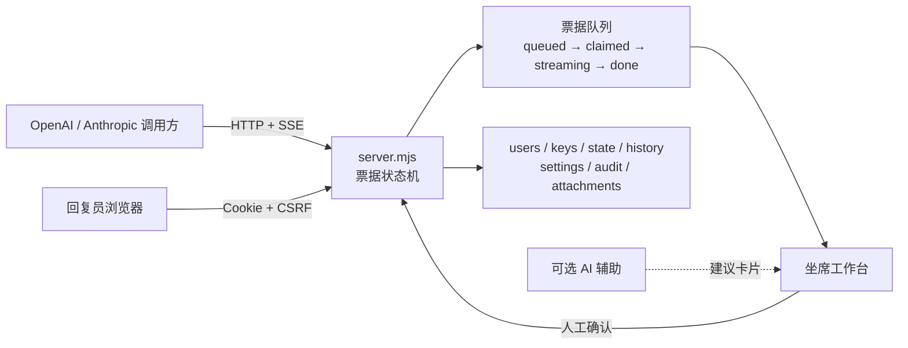

<p align="center">
  
</p>

<h1 align="center">能工智人 · nenggong-zhiren</h1>

<p align="center">
  <strong>把「模型回复」换成一个真实的人，同时保持 OpenAI / Anthropic 兼容接口。</strong>
</p>

<p align="center">
  人工票据队列 · Web 坐席工作台 · 管理后台 · 可选 AI 辅助 · 零运行时依赖
</p>

<p align="center">
  <a href="https://github.com/Mrtime-gege/nenggong-zhiren/releases"></a>
  <a href="LICENSE"></a>
  <a href="https://nodejs.org/"></a>
  
  
</p>

<p align="center">
  <a href="#快速开始">快速开始</a> ·
  <a href="#安全警示agent-工具不是沙箱">安全警示</a> ·
  <a href="#能做什么">能力</a> ·
  <a href="#架构">架构</a> ·
  <a href="#文档导航">文档</a>
</p>

---

> **这不是 AI 中转站，也不是无人值守客服。**
> 能工智人是人工回复工作台。调用方的请求进入票据队列，真正写回复的人是坐在浏览器工作台后面的回复员。管理员可以开启可选 AI 辅助，但它只提供摘要、翻译和草稿建议，**不会自动回复、自动发送或自动结束票据**。

## 30 秒理解

```text
OpenAI / Anthropic 请求
        │
        ▼
   票据进入队列
        │
        ▼
回复员在 Web 坐席认领
        │
        ├─ 人工编写正文
        ├─ 人工确认工具调用
        └─ 可选 AI 辅助起草
        │
        ▼
调用方收到标准协议响应
```

适合：内部工具、局域网协作、教学演示、人在环实验、需要人工审核的客户沟通。

不适合：冒充真实模型供应商、无人值守自动客服、公网匿名开放服务。

## 安全警示：Agent 工具不是沙箱

> [!WARNING]
> **当你把终端、文件系统、浏览器或依赖安装工具交给 Agent 时，本质上是在把当前用户权限下的电脑控制权交给一个自动化代理。**
>
> 很多安全事故并不是从外部网络强行突破，而是从系统内部获得一次执行机会开始的。一个可执行工具就足以读取凭据、修改配置、写入启动项、横向移动，或利用本机已有漏洞完成本地提权。能工智人本身只提供 OpenAI 兼容端点，不包含 Agent 执行器；在本项目的 DSH 使用场景中，终端、文件、浏览器等工具由 DSH 或宿主环境启用，风险取决于这些工具的实际权限和隔离方式。
>
> **不要把生产机、root/管理员账号、SSH 私钥、云凭据或包含客户数据的目录交给未隔离的 Agent。**
>
> 推荐的最小安全措施：
>
> - 在容器、虚拟机或专用低权限账号中运行 Agent；
> - 工作目录使用可回滚快照，敏感目录只读或完全不可见；
> - 高风险命令必须人工确认，避免无限制 shell；
> - 限制网络出口，默认拒绝不必要的出站连接；
> - 不把 `.env`、SSH key、云 token、`users.json`、`api-keys.json` 暴露给工作目录；
> - 记录并审查命令、文件修改和网络访问；发现异常先隔离，再排查提权与持久化。
>
> Agent 的便利性和本机执行权限是同一种东西。**先假设一次错误命令就可能改变整台机器，再决定给它什么权限。**

## 能做什么

| 能力 | 说明 |
| --- | --- |
| 聊天回复 | 非流式或流式 SSE |
| 工具调用 | JSON Schema 参数校验；人工确认后返回 |
| 结构化输出 | `json_object` / `json_schema`，不合法不发送 |
| 图片与附件 | 工作台预览；危险格式拒绝 |
| 会话聚合 | 同一会话按轮次聚合，一个进行中轮次 |
| 断线重连 | `Idempotency-Key` 恢复 SSE 或等待完成 |
| AI 辅助 | 结果卡片与详情随票据持久化；未认领也可查看；不自动填入或发送 |
| 自动 AI | 管理员开关；收到/认领后预生成卡片；不会自动回复调用方 |
| 统一导航 | 坐席 / 概览 / 记录 / 管理 / 设置；概览、记录、管理使用二级 Hub |
| 管理能力 | 用户、模型、API 密钥、配额、审计、历史、环境检查 |
| 可观测性 | 状态页、Prometheus `/metrics`、历史检索、审计、CSV |
| 页面性能 | 静态资源 ETag 条件缓存；Hub 相邻/悬停预载 |

## 架构



设计取舍：

- 单进程、文件持久化、零运行时依赖，方便自托管和审计；
- 协议层与人工工作流解耦；
- AI 辅助是可选旁路，不是自动回复链路；
- 管理员默认可以查看票据和审计，权限边界必须靠部署隔离补足。

## 快速开始

需要 Node.js 20+。基础功能不需要 `npm install`。

```bash
git clone https://github.com/Mrtime-gege/nenggong-zhiren.git
cd nenggong-zhiren
cp config.example.jsonc config.jsonc
node server.mjs
```

首次启动如果没有 `users.json`，终端会打印一次随机管理员密码：

```text
http://127.0.0.1:7355/login
```

登录后在「API 密钥」生成调用方 key，再发送第一个请求：

```bash
curl http://127.0.0.1:7355/v1/chat/completions \
  -H "Authorization: Bearer <key>" \
  -H "Content-Type: application/json" \
  -d '{"model":"human-1","messages":[{"role":"user","content":"你好"}]}'
```

详细安装、工作台和首个真实请求见 [快速启动](docs/quickstart.md)。

## 文档导航

| 文档 | 内容 |
| --- | --- |
| [快速启动](docs/quickstart.md) | 安装、启动、工作台、首次请求、常见问题 |
| [协议兼容性](docs/protocol.md) | OpenAI / Anthropic、流式、工具、JSON、幂等 |
| [部署](docs/deployment.md) | 配置、局域网、TLS、DSH 接入、systemd、备份 |
| [安全模型](docs/security.md) | 威胁模型、鉴权、限制、残余风险 |
| [架构](docs/architecture.md) | 请求生命周期、状态机、持久化边界、浏览器回归 |
| [更新记录](CHANGELOG.md) | 版本变更 |
| [安全政策](SECURITY.md) | 漏洞报告与支持范围 |

## 开发与验证

```bash
npm test              # 并行运行全部测试
npm run test:ci       # 单并发，适合 CI 和问题复现
npm run test:coverage # Node 原生覆盖率报告
npm start             # 启动服务
```

项目不依赖构建步骤，浏览器端使用原生 HTML/CSS/JavaScript。

当前自动化测试覆盖：

- OpenAI / Anthropic 协议、流式 SSE、工具、幂等和断线重连；
- 票据状态机、附件、AI、SQLite、历史、权限和审计；
- API Key、用量配额、设置、模型、JSONC 和安全边界；
- UI 静态契约、发布白名单和页面加载顺序。

## 安全边界

- 工具调用参数会校验，但工具由调用方自己执行；不要在不受限环境给陌生工具授权。
- 本项目是单进程参考实现，不提供多节点 HA。
- 部署应使用独立账号/密钥、TLS、网络 ACL 和集中审计。
- 可选媒体 worker 默认按 `config.jsonc` 的明确路径探测；发布包不包含 Python 脚本，缺失时自动跳过图片重编码，PDF 页图预览显示不可用。
- 不要把管理员密码、调用密钥、`users.json`、`api-keys.json`、数据库或附件提交到仓库。
- **Agent 工具、终端和浏览器不是本项目的安全边界；请把它们视为拥有本机执行权限的组件。**

完整边界和处理建议见 [安全模型](docs/security.md)；漏洞报告方式见 [SECURITY.md](SECURITY.md)。

## 发布

当前版本：**0.6.3**

- [GitHub Releases](https://github.com/Mrtime-gege/nenggong-zhiren/releases)
- 发布包只包含白名单文件，不包含配置、密钥、数据库、日志、附件和测试。

## License

[MIT](LICENSE)
